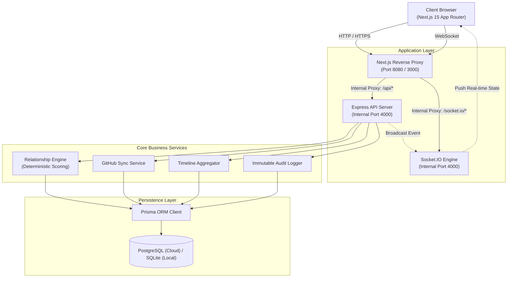
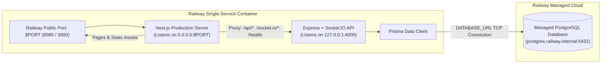
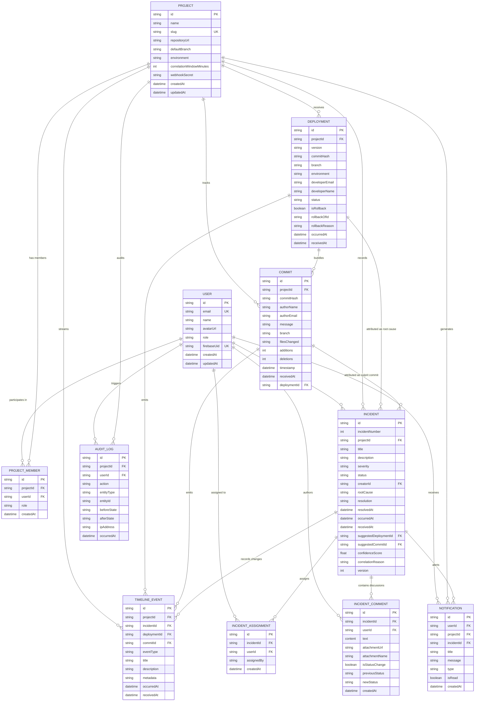

# Culprit (Who Broke The Build?)

Production Incident Attribution and Release Correlation Platform

Live Production Service: [https://culprit-production-0072.up.railway.app](https://culprit-production-0072.up.railway.app)  
GitHub Repository: [https://github.com/Dhyanesh2603/culprit](https://github.com/Dhyanesh2603/culprit)

Culprit is a high-availability incident intelligence and deployment correlation platform built for software engineering teams. During production outages, engineering teams often lose 30 to 45 minutes manually reconciling alerts across fragmented observability dashboards, CI/CD pipelines, and git logs to answer three fundamental questions:

1. Which deployment triggered this outage?
2. Which commit introduced the breaking change?
3. Which team members authored the relevant diffs and should be paged into the war room?

Culprit consolidates deployments, git commits, and incident events into a unified chronological stream. It executes a multi-factor mathematical correlation engine to determine release attribution, calculates confidence scores (0% to 99%), and surfaces human-readable justifications without generative hallucination.

---

## Table of Contents

- [Core Principles](#core-principles)
- [Key Features](#key-features)
- [System Architecture](#system-architecture)
- [Cloud Deployment Topology (Railway)](#cloud-deployment-topology-railway)
- [Entity-Relationship (ER) Diagram](#entity-relationship-er-diagram)
- [Database Schema Reference](#database-schema-reference)
- [Attribution Engine Scoring Algorithm](#attribution-engine-scoring-algorithm)
- [Tech Stack](#tech-stack)
- [Local Installation and Development](#local-installation-and-development)
- [Docker Production Stack](#docker-production-stack)
- [Railway Deployment Guide](#railway-deployment-guide)
- [API Reference](#api-reference)
- [Real-Time WebSocket Protocol](#real-time-websocket-protocol)
- [Repository Structure](#repository-structure)
- [Security and Verification](#security-and-verification)
- [License](#license)

---

## Core Principles

- **Deterministic Correlation, Not Generative Hallucinations:** Culprit uses multi-factor mathematical heuristics based on wall-clock proximity decay, critical path risk scoring, and deployment health flags. Attribution decisions are reproducible, explainable, and verifiable.
- **Strict Chronological Ordering with Ingestion Reconciliation:** Webhook events and deployment pings frequently arrive out of order due to network jitter or delayed CI/CD runners. Culprit records both `occurredAt` (the true event timestamp) and `receivedAt` (the ingestion timestamp), always sorting by `occurredAt` and flagging late arrivals.
- **Optimistic Concurrency Control (OCC):** Collaborative incident management involves simultaneous status updates, assignment adjustments, and commentary. Culprit uses integer `version` columns to detect concurrent updates and prevent stale overwrites.
- **Append-Only Auditing:** Incident states, resolution actions, and developer assignments are immutably logged to an audit table with before/after state snapshots.
- **Zero-Latency War Rooms:** State mutations broadcast immediately over Socket.IO to keep all triage participants synchronized without polling.
- **Dual-Database Portability:** Native Prisma configuration that runs on local SQLite for instant bare-metal development and switches automatically to managed PostgreSQL in containerized cloud environments.

---

## Key Features

### 1. Deterministic Relationship Engine
- Correlates incident timestamps against preceding releases and commit diffs within configurable lookback windows (default: 60 to 120 minutes).
- Evaluates risk weights based on touched files (database migrations, schemas, authentication guards, payment gateways, API routers).
- Computes normalized confidence percentages alongside explicit attribution reasons.

### 2. Live Incident War Room
- Real-time incident command center powered by WebSockets.
- Enforces strict incident state transitions: `OPEN` -> `INVESTIGATING` -> `MONITORING` -> `RESOLVED` -> `CLOSED`.
- Threaded incident discussion supporting markdown, image attachments, and user mentions.
- Automated one-click postmortem generation with timeline breakdowns and root cause summaries.

### 3. Deployments and Rollback Execution
- Tracks releases across isolated environments (`PRODUCTION`, `STAGING`, `DEVELOPMENT`).
- Supports one-click rollback triggers that emit compensation deployments and update target release states.
- File-level diff inspection detailing insertions, deletions, and affected modules.

### 4. Merged Event Timeline
- Aggregates git commits, releases, status adjustments, assignments, and resolution notes into a single chronological feed.
- Automatic late-ingestion detection highlights events where `receivedAt - occurredAt > 2 minutes`.

### 5. GitHub Repository Synchronization
- Connects to any public or private GitHub repository via REST API.
- Synchronizes branches, recent commit trees, author details, and file changes.
- Supports GitHub Personal Access Tokens for private repository access and extended rate limits.

### 6. Interactive Demo Lab and Target Sandbox
- Built-in simulation sandbox (`/demo`) for chaos engineering and manual testing.
- Pre-configured failure scenarios: Stripe SDK migration breakage, authentication token memory leaks, and database pool exhaustion.
- Allows operators to simulate incidents and observe live correlation scores without touching external production systems.

---

## System Architecture

The following diagram illustrates the component architecture and data flow:



---

## Cloud Deployment Topology (Railway)

Culprit supports a single-service unified container architecture for cloud deployment on Railway. Next.js serves the frontend UI on Railway's dynamic public port while routing internal API and WebSocket traffic to an Express instance listening on an internal loopback port.



---

## Entity-Relationship (ER) Diagram

The following diagram models the data layer managed by Prisma:



---

## Database Schema Reference

### 1. `users`
Stores user identity, role-based authorization levels, and profile metadata.
- `id` (String, PK, CUID): Unique record identifier.
- `email` (String, Unique): User email address.
- `name` (String): Full display name.
- `role` (String, Default: `DEVELOPER`): Authorization level (`ADMIN`, `DEVELOPER`, `VIEWER`).
- `firebaseUid` (String, Unique, Nullable): Optional external auth identity.

### 2. `projects`
Stores monitored microservices and software repositories.
- `id` (String, PK, CUID): Project identifier.
- `slug` (String, Unique): URL-safe project key.
- `repositoryUrl` (String): Public or private git repository link.
- `defaultBranch` (String, Default: `main`): Default branch monitored.
- `correlationWindowMinutes` (Int, Default: `60`): Lookback window for relationship calculations.
- `webhookSecret` (String, Nullable): HMAC secret for payload signature verification.

### 3. `deployments`
Tracks release executions across environments.
- `id` (String, PK, CUID): Deployment identifier.
- `projectId` (String, FK): Associated project.
- `version` (String): Release tag or build counter (e.g. `v2.4.1`, `build-104`).
- `commitHash` (String): Associated Git SHA.
- `status` (String): Status (`SUCCESS`, `FAILED`, `ROLLED_BACK`, `IN_PROGRESS`).
- `isRollback` (Boolean): Flag denoting compensation release.
- `occurredAt` (DateTime): True execution time from CI runner.
- `receivedAt` (DateTime): Ingestion timestamp.

### 4. `commits`
Stores ingested git commits and diff metrics.
- `id` (String, PK, CUID): Commit identifier.
- `projectId` (String, FK): Associated project.
- `commitHash` (String): Full or abbreviated Git SHA.
- `authorName` / `authorEmail` (String): Committer credentials.
- `filesChanged` (String, JSON): Serialized list of modified file paths and line delta metrics.
- `additions` / `deletions` (Int): Total modified line counts.
- `timestamp` (DateTime): Git commit creation timestamp.

### 5. `incidents`
Tracks outages, severity, operational status, and automated correlation attribution.
- `id` (String, PK, CUID): Incident identifier.
- `incidentNumber` (Int): Sequential human-readable incident number.
- `severity` (String): Severity tier (`LOW`, `MEDIUM`, `HIGH`, `CRITICAL`).
- `status` (String): Operational state (`OPEN`, `INVESTIGATING`, `MONITORING`, `RESOLVED`, `CLOSED`).
- `suggestedDeploymentId` (String, FK, Nullable): Attributed breaking release.
- `suggestedCommitId` (String, FK, Nullable): Attributed culprit commit.
- `confidenceScore` (Float): Attribution score (0.00 to 0.99).
- `correlationReason` (String): Formatted mathematical attribution justification.
- `version` (Int): Optimistic concurrency counter.

### 6. `incident_comments` & `incident_assignments`
- Manage war-room communication threads, status transition breadcrumbs, file attachments, and active responder rosters.

### 7. `timeline_events`
- Chronological event store indexing deployments, commits, comments, and status transitions, ordered by `occurredAt`.

### 8. `audit_logs`
- Append-only security audit trail recording before/after JSON states for all data mutations.

---

## Attribution Engine Scoring Algorithm

When an incident is reported with timestamp $T_{\text{incident}}$, Culprit searches for deployments and commits within lookback window $W$ (default: 60 to 120 minutes):

$$\Delta t = T_{\text{incident}} - T_{\text{deployment}}$$

### 1. Wall-Clock Proximity Score

$$\text{ProximityScore} = 50 \times \max\left(0, 1 - \frac{\Delta t}{W}\right)$$

Releases closer to the incident start receive higher proximity scores. A release executed 5 minutes before an outage receives $\approx 46$ points; a release executed 55 minutes prior receives $\approx 4$ points.

### 2. Deployment Health Penalty
- If deployment status is `FAILED`: $+35\text{ points}$
- If deployment was flagged as a `ROLLBACK`: $+20\text{ points}$

### 3. Commit File Risk Heuristics
Each commit associated with candidate deployments is evaluated across risk patterns:
- **Critical Path Matches:** Commits modifying sensitive modules (`schema.prisma`, `migrations/`, `auth/`, `gateway/`, `payment/`, `stripe`, `security/`, `docker-compose`): $+25\text{ points}$
- **Blast Radius Factor:** Commits touching extensive lines ($\text{additions} + \text{deletions} > 200$) or modifying $> 8\text{ files}$: $+15\text{ points}$

### 4. Composite Confidence Score

The combined deployment score and top commit score are normalized into a final confidence metric bounded between 0% and 99%:

$$\text{ConfidenceScore} = \min\left(0.99, \frac{(\text{TopDeploymentScore} \times 0.55) + (\text{TopCommitScore} \times 0.45)}{100}\right)$$

---

## Tech Stack

### Frontend
- **Framework:** Next.js 15 (App Router, Server and Client Components)
- **Library:** React 19, TypeScript
- **Styling:** Tailwind CSS, custom charcoal/amber design system
- **State & Caching:** TanStack React Query v5
- **Forms & Validation:** React Hook Form, Zod
- **Visualizations:** Recharts
- **Icons:** Lucide Icons
- **Real-Time Client:** Socket.IO Client

### Backend
- **Runtime:** Node.js 18+ / 20+, Express.js, TypeScript
- **Architecture:** Layered Architecture (Controllers, Services, Repositories, Routes, Middlewares)
- **Database Access:** Prisma ORM 5
- **Databases:** PostgreSQL (Production / Cloud), SQLite (Local zero-config)
- **Real-Time Engine:** Socket.IO Server
- **Security:** Helmet, CORS, HMAC SHA-256 Signature Verification
- **Validation:** Zod Schema Validation

---

## Local Installation and Development

### Prerequisites
- Node.js 18.x or 20.x
- npm 9+
- Git

### Installation Steps

1. Clone repository:
   ```bash
   git clone https://github.com/Dhyanesh2603/culprit.git
   cd culprit
   ```

2. Install dependencies:
   ```bash
   # Root install runs postinstall for both frontend and backend
   npm install
   ```

3. Setup local database and seed:
   ```bash
   cd backend
   cp .env.example .env
   npm run prisma:push
   npm run db:seed
   cd ..
   ```

4. Run development servers:
   ```bash
   # Run both frontend and backend concurrently
   npm run dev
   ```

5. Open [http://localhost:3000](http://localhost:3000) in your browser.

Default local accounts are available via the top-bar role selector:
- **Admin:** `admin@company.internal` (Full project and user administration)
- **Developer:** `alex.rivera@company.internal` (Incident triage, deployments, repository sync)
- **Viewer:** `viewer@company.internal` (Read-only access)

---

## Docker Production Stack

To run the complete production stack locally with PostgreSQL:

```bash
# Build and run PostgreSQL, Express backend, and Next.js frontend
docker compose up --build -d

# Check container status
docker compose ps
```

Services exposed:
- Web Application: [http://localhost:3000](http://localhost:3000)
- Backend API: [http://localhost:5000/api/v1](http://localhost:5000/api/v1)
- PostgreSQL Database: `localhost:5432`

To shut down containers and volumes:
```bash
docker compose down -v
```

---

## Railway Deployment Guide

This project includes unified single-service orchestration configured for Railway.

### 1-Click Deployment Steps

1. Log into your [Railway Dashboard](https://railway.app).
2. Click **New Project** -> **Deploy from GitHub repo**.
3. Select `Dhyanesh2603/culprit`.
4. Add a managed database:
   - Click **+ New** -> **Database** -> **Add PostgreSQL**.
5. Connect database to application:
   - Click on the **`culprit`** service.
   - Go to the **Variables** tab.
   - Click **New Variable** -> **Add Reference** -> select **Postgres** -> `DATABASE_URL`.
   - Click **Save**.
6. Expose the domain:
   - In the **`culprit`** service, go to **Settings** -> **Networking**.
   - Click **Generate Domain**.
   - Ensure the Target Port is set to **`8080`** (or the port assigned in your deployment logs).
7. Access the application at your generated `.up.railway.app` URL.

---

## API Reference

All REST API endpoints are versioned under `/api/v1/`:

| Method | Endpoint | Description | Access Level |
|---|---|---|---|
| `GET` | `/health` | Service liveness and readiness probe | Public |
| `GET` | `/api/v1/dashboard/summary` | Aggregated failure trends, MTTR, deployment frequency | Viewer+ |
| `GET` | `/api/v1/projects` | List all monitored projects | Viewer+ |
| `POST` | `/api/v1/projects` | Register new project | Admin |
| `POST` | `/api/v1/projects/connect-repo` | Connect GitHub repository URL and ingest commits | Developer+ |
| `POST` | `/api/v1/projects/:id/sync-github` | Synchronize latest remote Git commits | Developer+ |
| `GET` | `/api/v1/deployments` | List deployments across environments | Viewer+ |
| `POST` | `/api/v1/deployments` | Record deployment with idempotency checks | Developer+ |
| `POST` | `/api/v1/deployments/:id/rollback` | Execute rollback deployment | Developer+ |
| `GET` | `/api/v1/incidents` | List incidents with attribution results | Viewer+ |
| `POST` | `/api/v1/incidents` | Create incident and trigger relationship scoring | Developer+ |
| `GET` | `/api/v1/incidents/:id` | Get incident details, comments, and audit trail | Viewer+ |
| `PATCH` | `/api/v1/incidents/:id` | Update incident status (enforces OCC version check) | Developer+ |
| `POST` | `/api/v1/incidents/:id/assign` | Assign responder to incident | Developer+ |
| `POST` | `/api/v1/incidents/:id/comments` | Add comment or file attachment to war room | Developer+ |
| `GET` | `/api/v1/incidents/:id/postmortem` | Export generated markdown postmortem | Viewer+ |
| `GET` | `/api/v1/timeline/unified` | Merged chronological timeline feed | Viewer+ |
| `POST` | `/api/v1/demo/run-scenario` | Execute simulated chaos outage scenario | Developer+ |
| `POST` | `/api/v1/webhooks/github` | Ingest GitHub push and deployment webhooks | Public (HMAC verified) |

---

## Real-Time WebSocket Protocol

Culprit uses Socket.IO for live collaboration. Clients join project-level and incident-level rooms:

| Event Name | Direction | Payload Description |
|---|---|---|
| `join:project` | Client -> Server | String `projectId` to subscribe to project events |
| `leave:project` | Client -> Server | String `projectId` to unsubscribe |
| `join:incident` | Client -> Server | String `incidentId` to enter live war room |
| `leave:incident` | Client -> Server | String `incidentId` to leave live war room |
| `incident:created` | Server -> Client | New incident entity with attribution scores |
| `incident:updated` | Server -> Client | Updated incident state, severity, or resolution |
| `incident:comment` | Server -> Client | New war room discussion message or status transition |
| `deployment:created` | Server -> Client | Newly recorded deployment event |
| `timeline:new_event` | Server -> Client | Normalized timeline event item |

---

## Repository Structure

```
culprit/
├── backend/
│   ├── prisma/
│   │   ├── schema.prisma             # SQLite schema (local development)
│   │   ├── schema.postgresql.prisma  # PostgreSQL schema (cloud production)
│   │   └── seed.ts                   # Realistic engineering seed dataset
│   ├── scripts/
│   │   └── prepare-prisma.js         # Dynamic database schema switcher
│   ├── src/
│   │   ├── config/                   # Constants, roles, environment configuration
│   │   ├── controllers/              # HTTP request controllers
│   │   ├── middlewares/              # Auth, RBAC, error handling, Zod validation
│   │   ├── prisma/                   # Prisma database client singleton
│   │   ├── repositories/             # Database access repositories
│   │   ├── routes/                   # Express route definitions
│   │   ├── services/                 # Relationship engine and business logic
│   │   ├── sockets/                  # Socket.IO event handlers and rooms
│   │   ├── types/                    # Domain models and DTO interfaces
│   │   ├── utils/                    # ApiResponse, logger, HMAC signature verification
│   │   ├── validators/               # Zod request payload schemas
│   │   ├── app.ts                    # Express app initialization
│   │   └── server.ts                 # HTTP server bootstrap
│   ├── package.json
│   └── railway.json                  # Standalone backend Railway manifest
├── frontend/
│   ├── src/
│   │   ├── app/                      # Next.js 15 App Router pages and layouts
│   │   │   ├── (dashboard)/          # Dashboard, incidents, timeline, projects
│   │   │   ├── demo/                 # Interactive Demo Lab & sandbox page
│   │   │   ├── deployments/          # Deployment inspection and rollbacks
│   │   │   ├── incidents/            # Incident lists and war rooms
│   │   │   └── settings/             # Project settings and token management
│   │   ├── components/               # UI components, badges, charts, modal dialogs
│   │   ├── context/                  # AuthContext, ProjectContext, SocketContext
│   │   ├── lib/                      # API client, dynamic URL resolvers, utils
│   │   └── types/                    # Frontend TypeScript interfaces
│   ├── next.config.ts                # Reverse proxy rewrites and image patterns
│   ├── package.json
│   └── railway.json                  # Standalone frontend Railway manifest
├── scripts/
│   └── start-unified.js              # Fullstack single-container orchestrator
├── docker-compose.yml                # Multi-container production stack
├── Procfile                          # Cloud buildpack process declaration
├── railway.json                      # Monorepo unified Railway manifest
├── RAILWAY_DEPLOY.md                 # Cloud hosting reference manual
└── README.md                         # Project documentation
```

---

## Security and Verification

- **HMAC Signature Verification:** Incoming GitHub webhooks are validated against `x-hub-signature-256` using the project's configured secret to prevent unauthorized payload injection.
- **Role-Based Access Control (RBAC):** Endpoints enforce strict permissions across `ADMIN`, `DEVELOPER`, and `VIEWER` tiers.
- **Input Sanitization:** All request payloads are validated against strict Zod schemas before reaching the service layer.
- **Helmet Security Headers:** Content security policies, frameguards, and XSS filtering enabled on the API layer.
- **Immutable Audit Trail:** Sensitive state transitions (rollbacks, incident closures, severity changes) generate permanent audit log entries with origin IP addresses and timestamps.

---

## License

This project is licensed under the MIT License.
